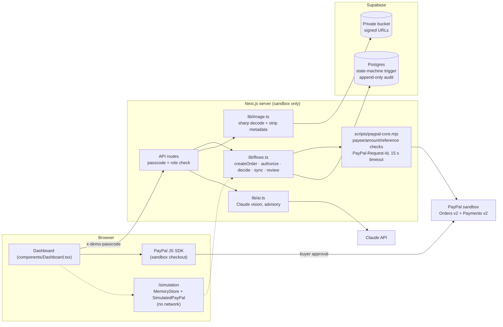
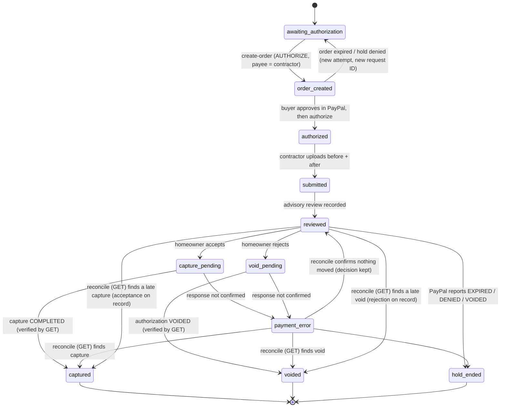

# PunchPay architecture

One Next.js 16 app. Every money-moving decision is made in one module, `lib/flows.ts`. That module is the only code that asks PayPal to move money. It is shared by three callers:

| Caller | Store | PayPal client | AI |
| --- | --- | --- | --- |
| API routes (`app/api/items/**`) | Supabase Postgres (`lib/server.ts`) | `PayPalSandbox` → PayPal **sandbox** REST | Claude vision (`lib/ai.ts`) |
| Offline simulation (`/simulation`) | `MemoryStore` (in the browser tab) | `PayPalSandbox` → `SimulatedPayPal` fetch fake | Pre-written fixtures, labeled |
| Regression tests (`tests/*.test.mjs`) | `MemoryStore` | `PayPalSandbox` → `SimulatedPayPal` | Fixtures |

So the simulation and the tests run the same decision and reconcile code as the live app. What changes is only what sits behind the store and the PayPal client.

## Money path for one item

## Guarantees and where they are enforced

| Guarantee | App (`lib/flows.ts`, core) | Database (migrations) |
| --- | --- | --- |
| The AI never moves money | `decide` never reads the report | n/a |
| One capture or void per item | Compare-and-set claim `reviewed → *_pending`; a GET of the authorization before every capture or void refuses a hold PayPal already settled; PayPal-Request-Id keyed on the authorization is a second layer, since its retention can lapse unsignalled | Transition whitelist; `capture_is_final`; unique PayPal IDs |
| Who gets paid | Payee is checked on the order, on the authorization (or via its parent order), and again before capture or void | `payee_merchant_id` recorded |
| Order ownership | `reference_id` = item ID, and the auth→order and capture→auth links are checked | Order, auth and capture IDs are immutable once set |
| No invented outcomes | "Unknown" only if the request may have reached PayPal. Reconcile is GET-only and refuses captures the homeowner did not accept | `captured` needs a capture ID + acceptance; `voided` needs a rejection |
| A decision cannot flip mid-flight | The same decision is retried with the same request ID | Decision immutable once recorded; evidence locked |
| Stale holds | Preflight GET; EXPIRED/DENIED → `hold_ended`; expiry shown | `hold_ended` must carry the PayPal status |
| Audit integrity | Audit failures never throw after money moved | Append-only rows; TRUNCATE blocked; `demo_runs` append-only; reset bypass only inside the reset function's owner context |
| Reset safety | n/a | Refuses while a capture or void is in flight, and while holds are open unless `punchpay_reset_demo(true)` |
| Evidence privacy | Re-encoded with sharp: decodes fully, pixel budget, EXIF/GPS dropped | Private bucket, 4 MB, image MIME types only |
| Access | `HOMEOWNER_PASSCODE` / `CONTRACTOR_PASSCODE` per role; `DEMO_PASSCODE` = presenter | RLS on, no browser grants |

## Not in scope (honest limits)
- Passcodes are a sandbox gate, not accounts. Production would need real authentication (e.g. Supabase Auth) with per-project membership.
- No PayPal webhooks. Reconciliation is manual (GET on demand).
- Single currency (USD) and full captures only.
- The AI report is advisory and is not an inspection or certification.
